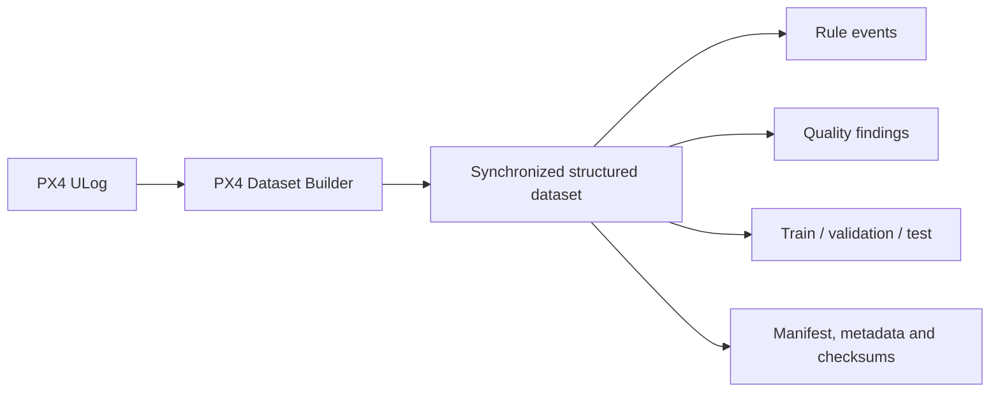
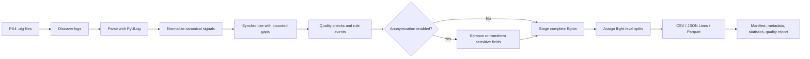

# PX4 Dataset Builder

[](https://github.com/LodeStonedrones/px4-dataset-builder/actions/workflows/ci.yml)
[](pyproject.toml)
[](LICENSE)
[](https://github.com/LodeStonedrones/px4-dataset-builder/releases)
[](docs/README.md)
[](https://docs.astral.sh/ruff/)

Build synchronized, documented, and privacy-aware datasets from one or more PX4 ULog (`.ulg`) flight logs.

## Real-world PX4 logs wanted

> [!IMPORTANT]
> We are looking for authorized PX4 ULogs to validate real-world compatibility. **Do not attach or link a log publicly.** Processing and anonymization remain local, and nothing is uploaded by this tool.

Choose the appropriate path before sharing anything:

| Path | Use it when | Start here |
|---|---|---|
| **Community Contribution** | A reviewed fixture or dataset may be publicly redistributed for compatibility, benchmarks, or open research | [Read the data guide](CONTRIBUTE_DATA.md#community-contribution), then open a [Dataset Contribution issue](https://github.com/LodeStonedrones/px4-dataset-builder/issues/new?template=dataset.yml) without attaching data |
| **LodeStone Research Partnership** | A university, laboratory, or company can authorize limited research use but not public release | [Read the private partnership requirements](CONTRIBUTE_DATA.md#lodestone-research-partnership), then contact LodeStone with a non-sensitive description only |

Useful evidence includes PX4 release/schema coverage, multiple sensor instances, missing or renamed GPS/IMU/estimator/battery fields, safe truncated logs, and challenging non-sensitive research conditions. We do not accept classified, export-controlled, military, customer-confidential, accident-investigation, personally identifying, or unauthorized operational data.

Read [Contributing PX4 flight data](CONTRIBUTE_DATA.md) for anonymization, rights, licensing, contact, retention, and transfer rules. Opening an issue or contacting LodeStone does not authorize file transfer or grant data rights.

> [!NOTE]
> **Project status: alpha.** The current release is validated with the deterministic synthetic ULog included in this repository. No real-world PX4 release is claimed as validated yet.

[Quick start](#quick-start) · [Real-world compatibility](#real-world-compatibility-matrix) · [Contribute data](CONTRIBUTE_DATA.md) · [Documentation](docs/README.md) · [Privacy](docs/privacy/PRIVACY.md) · [Contribute code](CONTRIBUTING.md)

## One-minute overview



```text
flight.ulg
  → canonical, synchronized flight tables
  → events + quality report
  → complete-flight train / validation / test splits
  → Parquet, CSV, or JSON Lines with reproducibility evidence
```

Everything runs locally. The owner previews the generated artifacts and decides separately whether to share them.

## Why this exists

ULogs are rich but heterogeneous: uORB fields change across PX4 releases, topics run at different frequencies, real fleets have missing data, and a naive row split leaks samples from the same flight into training and test. PX4 Dataset Builder provides a reproducible boundary between source logs and downstream analysis:

- canonical signal names and units mapped from documented uORB field candidates;
- gap-aware, signal-specific synchronization;
- explicit missing-data and quality findings;
- flight/group-level training, validation, and test splits;
- optional coordinate and metadata anonymization;
- CSV, JSON Lines, and compressed Parquet outputs;
- a manifest describing provenance, population, events, failures, and split distribution.

Processing is local. The application makes no network request and never uploads a log. It contains no proprietary navigation, anti-jamming, sensor-fusion, control, AI, or commercial decision logic. Event labels are ordinary configurable rules, not ground truth or flight-safety verdicts.

## Quick start

Python 3.12 or newer is required. There is no PyPI release yet. The shortest clean-install path is:

```bash
python3.12 -m venv .venv && source .venv/bin/activate
python -m pip install "git+https://github.com/LodeStonedrones/px4-dataset-builder.git"
px4-dataset generate-example && px4-dataset build synthetic-flight.ulg
```

The last command creates a deterministic, non-operational ULog and builds the first dataset in `./dataset`. Confirm its integrity and inspect its statistics:

```bash
px4-dataset validate dataset
px4-dataset stats dataset
```

<!-- Screenshot placeholder: docs/assets/cli-build.png — terminal showing generate-example,
build, validation, and statistics with no user-specific paths. See docs/assets/README.md. -->

For development from a clone:

```bash
git clone https://github.com/LodeStonedrones/px4-dataset-builder.git
cd px4-dataset-builder
python3.12 -m venv .venv
source .venv/bin/activate
python -m pip install -e '.[dev]'
make check
```

Build a directory recursively with four worker processes:

```bash
px4-dataset build ./logs --output ./dataset --format parquet --workers 4
```

Enable the configured anonymization policy:

```bash
px4-dataset init-config --output config.yaml
px4-dataset build ./logs --config config.yaml --anonymize
```

Review `config.yaml` before processing operational logs. The default thresholds are transparent examples and may not be appropriate for a particular vehicle or experiment.

## Pipeline



See the [architecture documentation](docs/architecture/ARCHITECTURE.md) for the architecture, dataset-generation, and single-flight processing diagrams.

## Compatibility

Status meanings:

- **Validated** — exercised by automated tests in this repository;
- **Experimental** — expected to work, but not covered by the complete CI/fixture matrix;
- **Planned** — roadmap work, not currently claimed as supported.
- **Not yet validated** — no accepted real-world fixture supports a compatibility claim.

### Real-world Compatibility Matrix

Only authorized, reviewable real-world evidence belongs in this table. A parser successfully opening a file is not sufficient for a compatibility claim.

| PX4 version | Real ULogs tested | Provenance / dataset | Sensor coverage | Result |
|---|---:|---|---|---|
| PX4 v1.14.x | 0 | No authorized fixture accepted yet | — | **Not yet validated** |
| PX4 v1.15.x | 0 | No authorized fixture accepted yet | — | **Not yet validated** |
| PX4 v1.16.x | 0 | No authorized fixture accepted yet | — | **Not yet validated** |
| PX4 v1.17.x | 0 | No authorized fixture accepted yet | — | **Not yet validated** |
| PX4 v1.18 pre-release | 0 | No authorized fixture accepted yet | — | **Not yet validated** |
| Other releases | 0 | No authorized fixture accepted yet | — | **Not yet validated** |

To help populate the matrix, begin with [CONTRIBUTE_DATA.md](CONTRIBUTE_DATA.md). Do not send a log before its path, rights, and privacy conditions have been agreed.

### Synthetic CI evidence

| Source | Logs | Topics | Duration | Result |
|---|---:|---:|---:|---|
| Project-generated, non-operational ULog | 1 | 11 | 5 seconds | **Validated end-to-end in CI** — not a real PX4-release claim |

### Operating systems

| Environment | Status | Evidence |
|---|---|---|
| Linux, Python 3.12 and 3.13 | **Validated** | GitHub Actions unit, integration, type, package, and quality jobs |
| Linux container | **Validated** | Docker image is built in CI and runs as a non-root user |
| macOS | **Experimental** | Supported by the Python packaging model, but not part of CI |
| Windows | **Planned** | No automated Windows validation yet |

### Outputs

| Output | Status | Evidence |
|---|---|---|
| Parquet with Zstandard compression | **Validated** | Parametrized end-to-end integration test |
| CSV | **Validated** | Parametrized end-to-end integration test |
| JSON Lines | **Validated** | Parametrized end-to-end integration test |
| Manifest, metadata, events, statistics, and quality JSON | **Validated** | End-to-end build and dataset validation tests |
| ROS 2 bag / MCAP | **Not planned in core** | PyULog already provides `ulog2ros2bag`; document that maintained path instead of duplicating it |

The living measurement and evidence policy is in [Benchmarks and compatibility evidence](docs/benchmarks.md).

## Dataset layout

```text
dataset/
├── train/flights/             # complete flights assigned to training
├── validation/flights/        # complete flights assigned to validation
├── test/flights/              # complete flights assigned to test
├── flights/index.json         # flight → split/data/metadata mapping
├── events/events.parquet      # or .csv/.jsonl
├── metadata/
│   ├── <flight_id>.json
│   ├── signal_schema.json
│   └── effective_config.json
├── statistics/summary.json
├── data_quality_report.json
└── manifest.json
```

<!-- Screenshot placeholder: docs/assets/dataset-tree.png — generated directory tree only.
Additional placeholders for event and statistics output are specified in docs/assets/README.md. -->

Each flight table is wide and ordered by `time_s`. `timestamp_us` retains the original ULog clock unless anonymization is enabled. A signal appears only when a documented uORB candidate exists. Missing intervals remain null when a gap exceeds `max_interpolation_gap_s`.

The global manifest contains flight/sample counts, total duration, available sensor families, PX4 versions, event and split distributions, failed logs, quality summary, the effective configuration digest, and SHA-256/size evidence for every generated artifact. Builds are staged beside the destination and installed only after all outputs are complete.

## Canonical signals

The v0.1 catalog covers:

- GPS position, altitude, NED velocity, heading, fix type, satellite count, EPH, and EPV;
- local position and velocity;
- quaternion attitude plus derived roll, pitch, and yaw;
- accelerometer, gyro, magnetometer, and barometer;
- voltage, current, remaining fraction, discharged capacity, and battery warning;
- actuator outputs, navigation mode, arming state, failsafe, land state, and mission sequence;
- public estimator flags, reset counters, test ratios, and selected innovations;
- acceleration and gyro vibration metrics.

Mappings, units, sensitivity, valid ranges, and interpolation policies live in `topics/catalog.py` and are copied to `metadata/signal_schema.json`. Unknown or unavailable fields are not guessed.

## Event rules

The default YAML demonstrates `gps_lost`, `gps_degraded`, satellite/EPH/EPV checks, estimator reset/warning, vibration, battery levels, failsafe, takeoff, landing, mode change, and sensor gaps. Logged PX4 warning and error messages are extracted separately as timestamped events.

Four rule kinds are supported:

- `threshold`: contiguous interval satisfying a simple comparison;
- `change`: a finite state or counter value changes;
- `edge`: a comparison changes from false to true;
- `gap`: a null interval exceeds a duration.

Every rule-derived event records the rule name, signal, observed value, threshold, interval, severity, and description. Overlapping events remain visible. These are configurable observations, not automatically validated anomaly labels.

## Methodology and privacy

PX4 topics are asynchronous. The builder creates a regular flight-relative grid, 10 Hz by default. Continuous quantities use bounded linear interpolation; states use bounded previous-value semantics; and headings and quaternions use bounded nearest samples. Previous/nearest values may be carried beyond the final source observation only within the configured gap; the output grid never extends beyond the logged flight duration. Read [Resampling and methodology](docs/methodology/RESAMPLING.md) before publishing results.

All samples from one flight remain in exactly one split. Available strategies are seeded random flight assignment, stable flight hash, drone group, UTC date group, and complete event-signature stratification. Researchers must choose and audit the group representing their real generalization boundary.

Anonymization is opt-in because modifying evidence must be deliberate. It reduces exposure but cannot guarantee anonymity: motion patterns, timing, vehicle configuration, rare events, and hashes may still identify a flight. Read [Privacy and data governance](docs/privacy/PRIVACY.md) and obtain permission before sharing.

## Performance

Workers process independent logs and return one processed flight at a time to the coordinator, which stages completed tables. Multiprocessing therefore incurs DataFrame serialization and its scaling has not yet been benchmarked. Parquet uses Zstandard compression. No 100-log or 1,000-log public benchmark has been published. See [Benchmarks](docs/benchmarks.md) for the reproducibility protocol and empty results template.

Pandas is used because PyULog exposes NumPy arrays and Pandas provides mature time-series and export behavior. No alternative dataframe engine is planned unless published measurements identify a bottleneck that materially blocks adoption.

## Docker

```bash
docker build -t px4-dataset-builder .
docker run --rm \
  -v "$PWD/logs:/logs:ro" \
  -v "$PWD/dataset:/output" \
  px4-dataset-builder build /logs --output /output
```

The runtime is non-root and contains no cloud configuration.

## Documentation

| Topic | Document |
|---|---|
| Documentation map | [docs/README.md](docs/README.md) |
| Architecture and module boundaries | [docs/architecture/ARCHITECTURE.md](docs/architecture/ARCHITECTURE.md) |
| Quick-start tutorial | [docs/tutorials/QUICKSTART.md](docs/tutorials/QUICKSTART.md) |
| Contributing or collaborating with flight data | [CONTRIBUTE_DATA.md](CONTRIBUTE_DATA.md) |
| Privacy and data governance | [docs/privacy/PRIVACY.md](docs/privacy/PRIVACY.md) |
| Resampling methodology | [docs/methodology/RESAMPLING.md](docs/methodology/RESAMPLING.md) |
| Benchmarks and evidence | [docs/benchmarks.md](docs/benchmarks.md) |
| Project governance | [docs/community/GOVERNANCE.md](docs/community/GOVERNANCE.md) |
| Requirements and non-goals | [docs/REQUIREMENTS.md](docs/REQUIREMENTS.md) |
| Roadmap | [docs/ROADMAP.md](docs/ROADMAP.md) |

## Project status and ecosystem relationship

v0.1 is a working alpha validated by unit and end-to-end tests using a deterministic synthetic ULog. It does not claim a real-flight PX4 compatibility matrix. Development is adoption-first: release fixtures, measured evidence, and a safe contribution workflow take precedence over new formats or interfaces. ROS 2 bags, HDF5/Arrow IPC, web/desktop interfaces, hosted publishing, Flight Review duplication, ArduPilot/MAVLink parsing, cloud execution, and a dataset registry are outside the current core roadmap.

The parser is built on [PX4/PyULog](https://github.com/PX4/pyulog). This project focuses on local, synchronized dataset preparation, privacy controls, and flight-level dataset splits. It is complementary to [PX4 Flight Review v2](https://github.com/PX4/flight-review-rs), which provides log conversion, diagnostics, and interactive review.

PX4 Dataset Builder is an independent community project. It is not an official PX4 project and is not affiliated with or endorsed by PX4 or the Dronecode Foundation.

## Community

### Contributing

For code, tests, documentation, or methodology, start with [CONTRIBUTING.md](CONTRIBUTING.md) and the [contributor onboarding guide](docs/community/CONTRIBUTOR_GUIDE.md). For flight data, first read [CONTRIBUTE_DATA.md](CONTRIBUTE_DATA.md) and choose either a public **Community Contribution** or a separately governed, private **LodeStone Research Partnership**. Never attach or link sensitive data in a public issue or Discussion. The proposed Discussion structure is documented in [GitHub Discussions](docs/community/DISCUSSIONS.md).

### Contributor recognition

Code, documentation, review, reproducibility work, public methodology, and authorized fixture contributions all count. Recognition rules are documented in [Contributor Recognition](docs/community/RECOGNITION.md).

### Acknowledgements

The project depends on public PX4 formats and the work of the PyULog and broader Python open-source communities. See [Acknowledgements](docs/community/ACKNOWLEDGEMENTS.md). Acknowledgement does not imply endorsement.

### Research citations

No DOI has been issued. Until an immutable release archive exists, cite the exact version and commit used together with the repository URL. See [Research citation guidance](docs/community/CITATION.md) and [`CITATION.cff`](CITATION.cff).

### Community roadmap

Milestones describe exit criteria rather than promised dates. Compatibility evidence, privacy review, stable schemas, and contributor feedback take priority over feature count. See the [community strategy](docs/community/STRATEGY.md) and [roadmap](docs/ROADMAP.md).

Technical decisions and maintainer responsibilities are described in [Project Governance](docs/community/GOVERNANCE.md).

## License

This project is licensed under the [Apache License 2.0](LICENSE), a permissive open-source license with an explicit patent license covering applicable contributor patent claims.

The license covers this project. It does not grant rights to use PX4 or other third-party trademarks. PX4 is referenced solely to describe technical compatibility.
